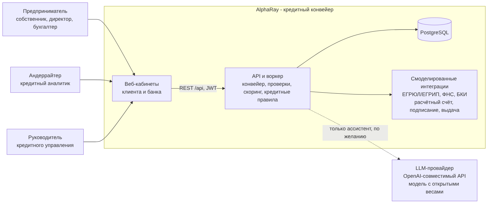
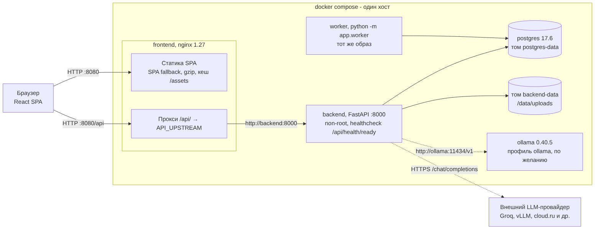
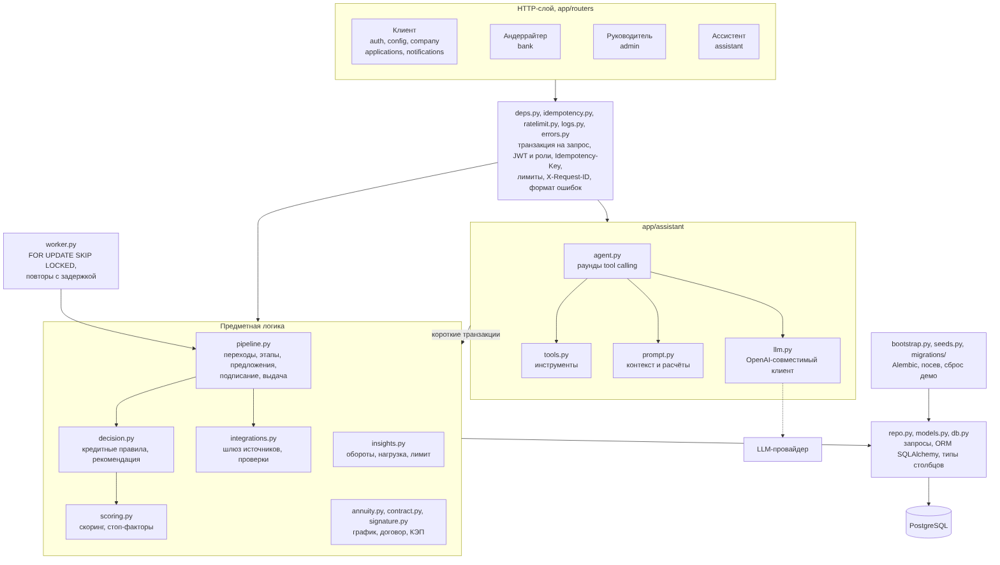
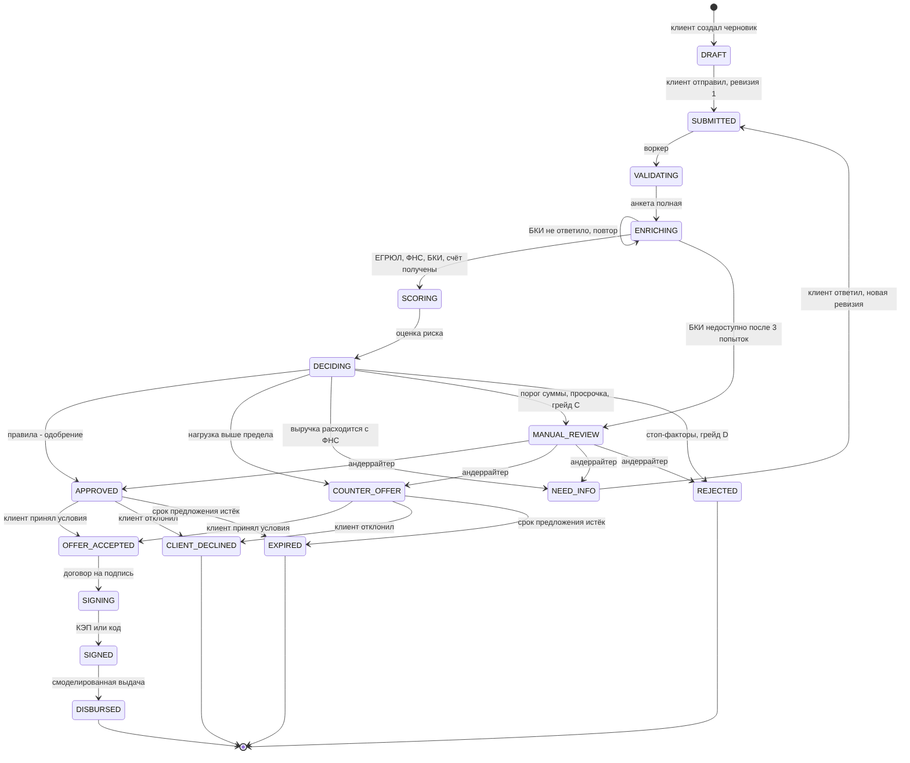
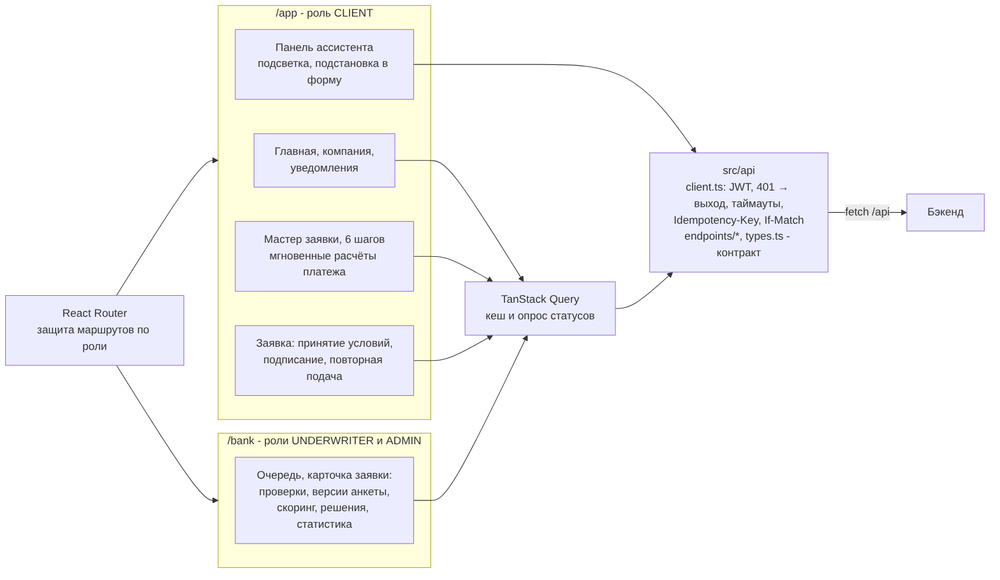
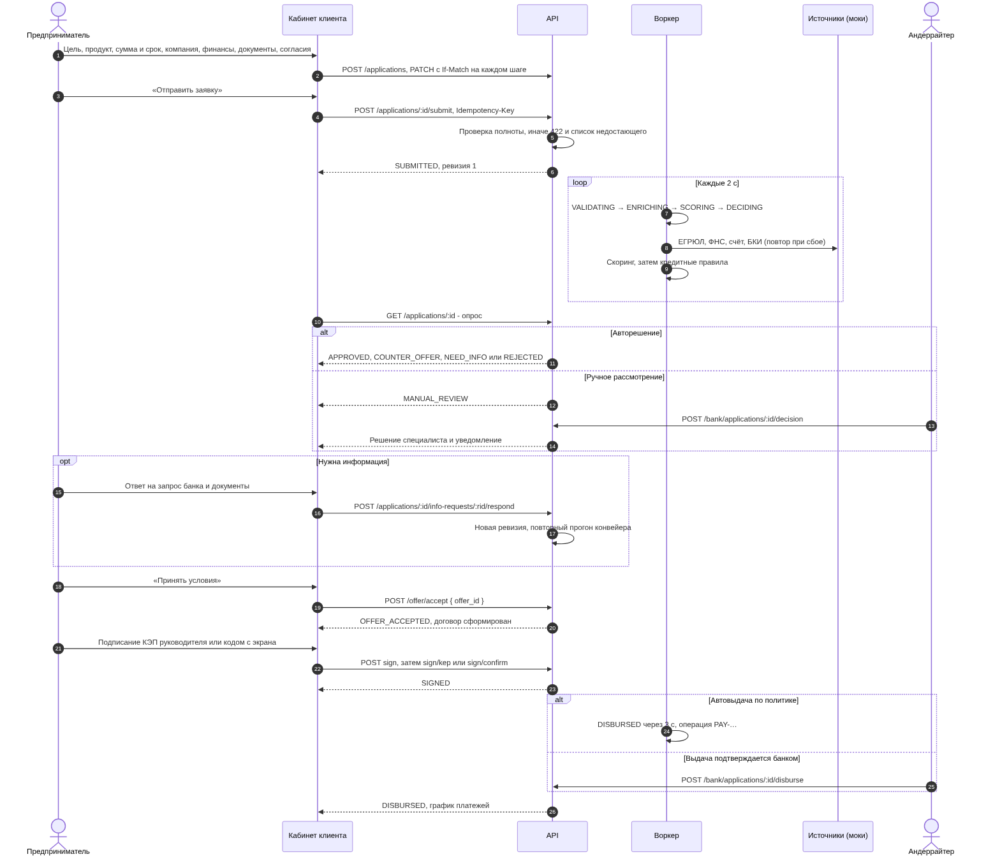
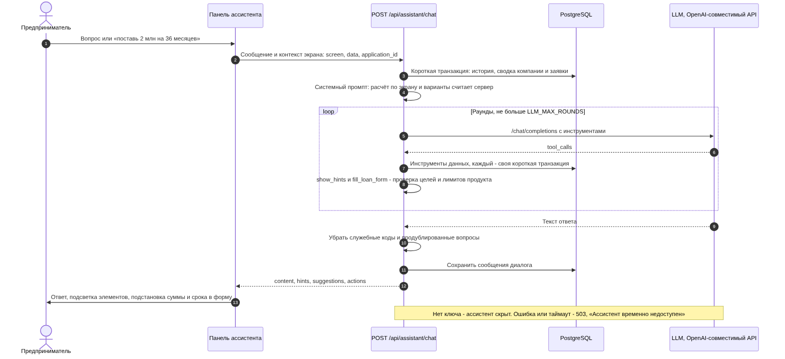
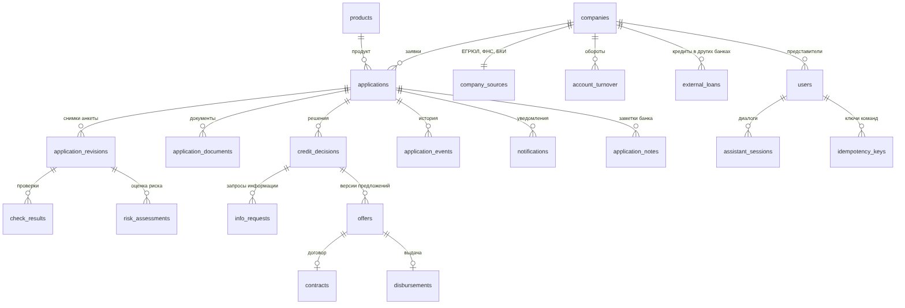

# AlphaRay - умный кредитный кабинет

Прототип кредитного конвейера для малого бизнеса.

## Архитектура

### Контекст системы



### Контейнеры



### Бэкенд



### Статусы заявки



### Фронтенд



### Путь заявки



### Ассистент



### Модель данных



ЕГРЮЛ, ФНС, БКИ, подписание и выдача смоделированы с синтетическими данных.
Подробно - [docs/architecture.md](docs/architecture.md).

## Компоненты

- Бэкенд: Python 3.13, FastAPI, SQLAlchemy, Alembic.
- База: PostgreSQL 17.6.
- Фронтенд: React 18, TypeScript, Vite.
- Запуск: Docker Compose.

Версии зафиксированы в `backend/poetry.lock` и `frontend/package-lock.json`.

## Запуск

```bash
docker compose up --build
```

Откройте http://localhost:8080. Пароль у всех учёток - `demo`.

## Переменные окружения

Всё работает без настроек. При желании:

- `.env` (шаблон `.env.example`) - пароль базы
- `backend/.env` (шаблон `backend/.env.example`) - ключ `LLM_API_KEY` для Ассистента.

## Учётки

| Почта | Что покажет |
|---|---|
| `client1@demo.local` | одобрение и выдача |
| `client3@demo.local` | ручное рассмотрение |
| `client4@demo.local` | отказ |
| `client5@demo.local` | запрос информации |
| `underwriter@bank.local` | кабинет андеррайтера |
| `admin@bank.local` | кабинет руководителя |

см. [frontend/DEMO_ACCOUNTS.txt](frontend/DEMO_ACCOUNTS.txt).

## Документация

- [docs/architecture.md](docs/architecture.md) - схема, статусы заявки, модель данных.
- [docs/api/openapi.json](docs/api/openapi.json) - API, Swagger
