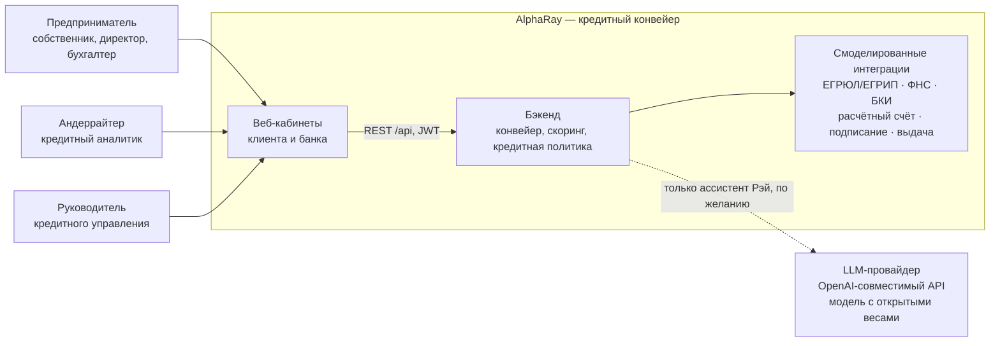
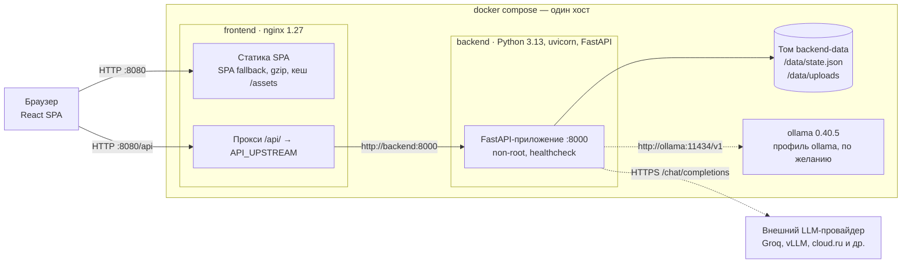
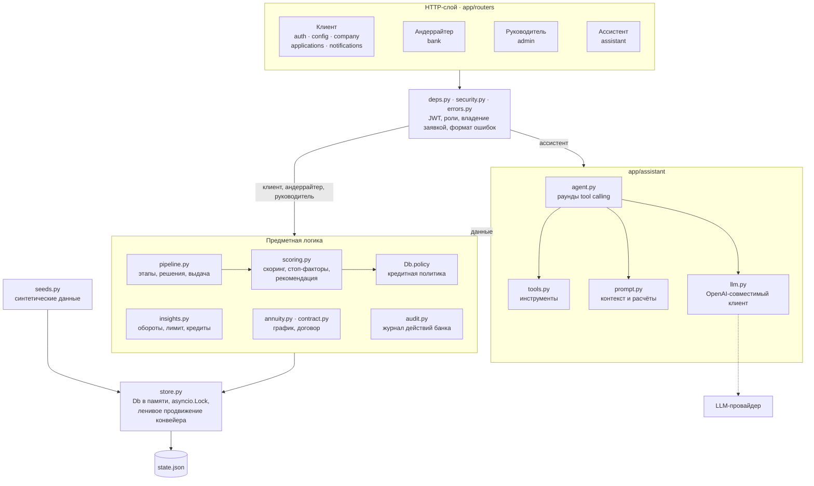
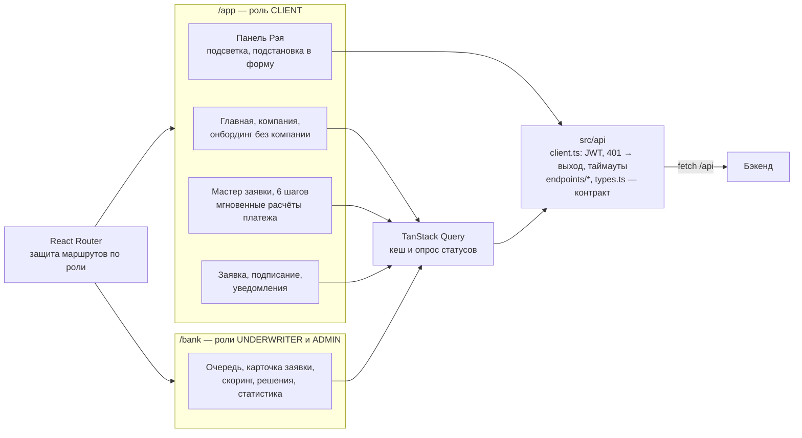
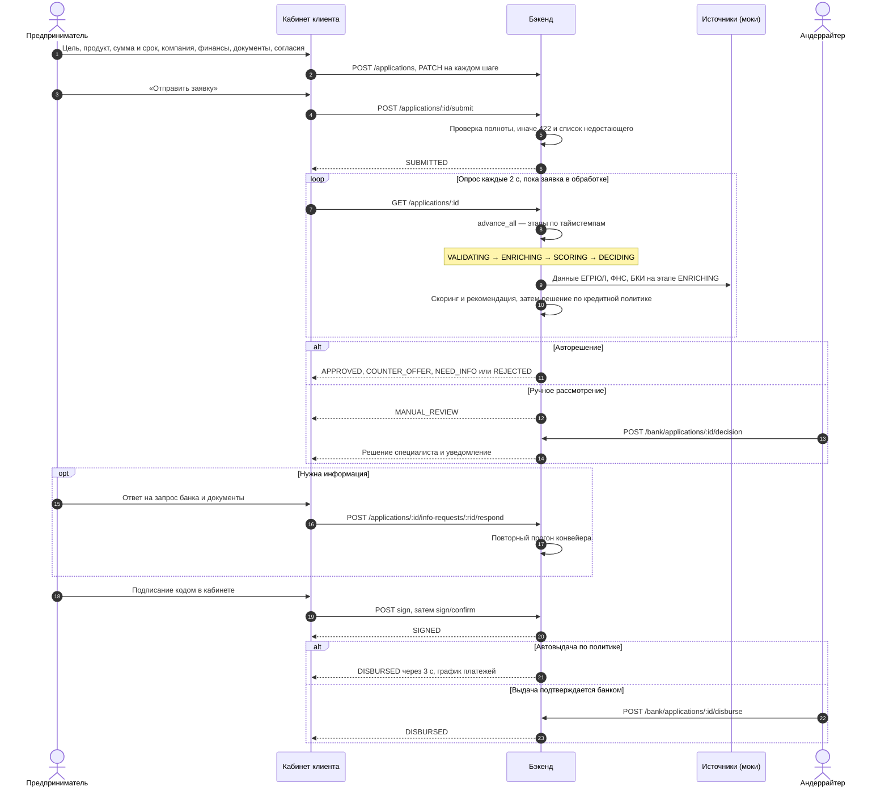
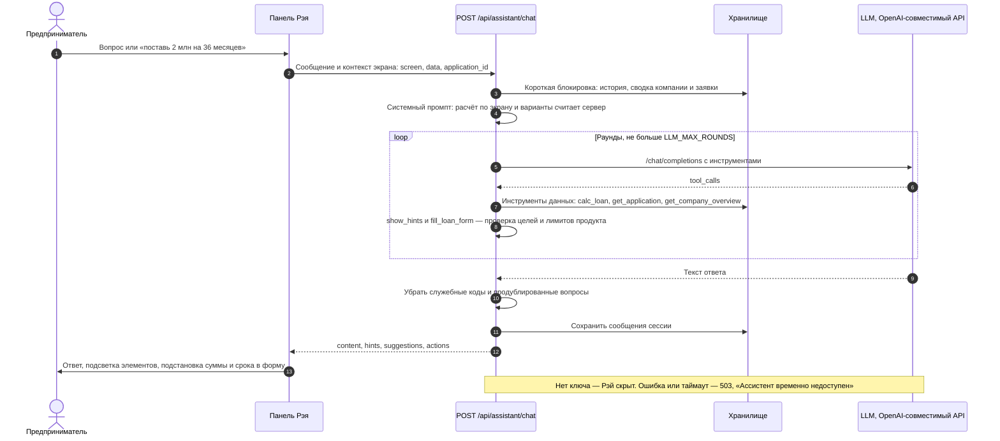

# Архитектура AlphaRay

AlphaRay — прототип цифрового кредитного конвейера для малого и микробизнеса. Один продукт объединяет три роли: предприниматель подаёт заявку и проходит путь до выдачи, андеррайтер разбирает нестандартные заявки, руководитель кредитного управления настраивает политику, продукты и распределение работы. Заявка проходит по единому конвейеру; данные и состояние хранятся на бэкенде, фронтенд их только отображает.

Схемы ниже — Mermaid, GitHub рисует их прямо на странице.

## 1. Контекст системы

- Весь сценарий проходит внутри продукта: без почты, SMS и мессенджеров. Уведомления, запросы банка, предложения и подписание — в кабинете.
- Внешние источники смоделированы на бэкенде с сохранением смысла интеграции: данные ЕГРЮЛ/ФНС/БКИ и обороты по счёту — синтетические (`backend/app/seeds.py`), подписание — код в кабинете, выдача — смена статуса и запись в график.
- LLM нужна только ассистенту. Без ключа Рэй скрыт, основной сценарий от него не зависит, платные ресурсы для проверки не требуются.

## 2. Контейнеры и развёртывание

| Контейнер | Образ и сборка | Порт | Данные | Проверка и перезапуск |
|---|---|---|---|---|
| `frontend` | multi-stage: `node:22-alpine` собирает Vite, `nginx:1.27-alpine` отдаёт статику | `8080 → 80` | — | `wget /`, `restart: unless-stopped`, стартует после `backend: healthy` |
| `backend` | `python:3.13-slim`, зависимости из `poetry.lock` с проверкой хешей | `8000`, только внутри сети compose | том `backend-data` → `/data` | `GET /api/health`, `restart: unless-stopped` |
| `ollama` + `ollama-pull` | `ollama/ollama:0.40.5`, профиль `ollama` | `11434`, внутри сети | том `ollama-models` | скачивает модель `OLLAMA_MODEL` при первом запуске |

Запуск одной командой: `docker compose up --build` из корня. Конфигурация бэкенда — `backend/.env` (шаблон `backend/.env.example`), версии зафиксированы в `backend/poetry.lock` и `frontend/package-lock.json`.

## 3. Бэкенд

| Модуль | Ответственность |
|---|---|
| `app/routers/*` | REST API под `/api`: клиент (`auth`, `config`, `company`, `applications`, `notifications`), андеррайтер (`bank`), руководитель (`admin`), ассистент (`assistant`), служебное (`health`, `demo/reset`) |
| `app/deps.py`, `app/security.py` | разбор JWT, проверка роли (`CLIENT`, `UNDERWRITER`, `ADMIN`) и активности учётки, доступ клиента только к заявкам своей компании, сессия хранилища на время запроса |
| `app/pipeline.py` | переходы статусов, события и уведомления, решения (авто по политике и ручные), встречные предложения, запрос информации, выдача, автораспределение |
| `app/scoring.py` | скоринг по 7 факторам (возраст бизнеса, выручка к сумме, платежи к выручке, платёжная дисциплина, рейтинг БКИ, динамика выручки, рентабельность), стоп-факторы, рекомендация, расхождения с ФНС |
| `Db.policy` | кредитная политика: пороги грейдов, авторешения и надбавки по грейдам, пороги ручного рассмотрения (общий и по продуктам), SLA, срок предложения, автораспределение, автовыдача. Скоринг даёт оценку риска, политика — решение и условия |
| `app/insights.py` | обороты по счёту, чистый денежный поток, долговая нагрузка, предварительный лимит с учётом текущих кредитов, действующие кредиты, отчёт БКИ с собственными кредитами банка, предзаполнение финансов |
| `app/annuity.py`, `app/contract.py` | аннуитетный платёж, график, HTML договора |
| `app/audit.py` | журнал действий банка: решения, назначения, заметки, выдачи, изменения продуктов, политики и сотрудников |
| `app/assistant/*` | ассистент Рэй — раздел 6 |
| `app/store.py` | единственный экземпляр состояния, сериализованный доступ, сохранение на диск |

### Ленивый конвейер

Фоновых воркеров нет. Каждый запрос к API под блокировкой хранилища вызывает `advance_all`: заявки, у которых истекло время этапа, переходят дальше (по 2 с на этап, решение, выдача через 3 с после подписания). Время каждого перехода считается от момента входа в этап, а не от момента запроса, поэтому история событий получается такой же, как при работе с воркером. Плюсы для прототипа — детерминизм и тестируемость: тесты управляют часами и проверяют весь путь без ожидания. Минус — нет масштабирования на несколько процессов; путь к промышленной версии — в разделе 9.

## 4. Фронтенд

- Всё общение с бэкендом — через `src/api`: остальное приложение не знает про HTTP. Типы в `src/api/types.ts` зеркалят `backend/app/schemas.py` и схему `docs/api/openapi.json`.
- Статусы обновляются опросом: карточка заявки в обработке — каждые 2 с, подписание — 1 с, очередь андеррайтера — 5 с, список заявок в обработке — 5 с, уведомления и главная — 10 с.
- На клиенте остались только мгновенные расчёты интерфейса: платёж при движении ползунков, «впишется ли платёж», предоценка. Решение, скоринг, договор и график считает бэкенд.

## 5. Сквозной кредитный путь

Каждый переход пишет событие в историю заявки, этапы конвейера и решения дополнительно создают уведомление клиенту, а действия сотрудников банка попадают в журнал аудита. Исходы для пяти демо-компаний зафиксированы сценарием (`frontend/DEMO_ACCOUNTS.txt`), остальные заявки решаются по кредитной политике.

## 6. Ассистент Рэй

- Провайдер меняется переменными `LLM_BASE_URL`, `LLM_API_KEY`, `LLM_MODEL`; используются только модели с открытыми весами (по умолчанию `openai/gpt-oss-120b` у Groq).
- Цифры считает сервер, а не модель: платёж, переплата, доля в потоке, варианты условий и лимит приходят в промпт готовыми.
- Рэй объясняет и умеет одно действие — по просьбе клиента подставить сумму и срок в форму. Подсказки и действия проверяются на сервере: цели подсветки — по списку текущего экрана, сумма и срок — по границам продукта.
- Блокировка хранилища не держится во время запроса к LLM: инструменты берут её коротко, остальные запросы не ждут ассистента.

## 7. Данные

Состояние — один документ `Db` (`backend/app/models.py`): пользователи, компании с данными источников, продукты, заявки с событиями, уведомления, сессии ассистента, кредитная политика, журнал аудита, заметки андеррайтеров. Документ версионируется (`DB_VERSION`): при несовместимой версии демо-данные пересоздаются. Запись атомарная — во временный файл и `os.replace`, только если состояние изменилось. Загруженные документы лежат в `/data/uploads/<заявка>/<документ>`.

Заявка хранит снимок продукта и компании на момент создания: изменение каталога администратором не меняет условия уже поданных заявок.

## 8. Безопасность и надёжность

| Область | Как устроено |
|---|---|
| Аутентификация | JWT HS256 со сроком 12 ч, секрет — `JWT_SECRET` из окружения; пароли — PBKDF2-SHA256, 120 000 итераций |
| Авторизация | роли `CLIENT`, `UNDERWRITER`, `ADMIN` на каждом эндпоинте; клиент видит только заявки своей компании; инструменты Рэя читают данные только своей компании; заблокированный сотрудник получает 403 при входе и 401 на старый токен |
| Аудит | журнал действий банка с автором, ролью и временем: решения, назначения, заметки, выдачи, изменения продуктов, политики и сотрудников |
| Секреты и контейнеры | `.env` не попадает в репозиторий и образы; бэкенд работает не от root; лимит загрузки 20 МБ в nginx и на бэкенде |
| Недоверенный контент | договор собирается на сервере с экранированием и показывается в iframe с `sandbox`; ответ LLM очищается от служебных кодов, подсказки и действия валидируются |
| Отказоустойчивость | healthcheck и автоперезапуск контейнеров; фронтенд стартует после готовности бэкенда; состояние переживает перезапуск; последовательный доступ к состоянию исключает гонки переходов |
| Внешние сервисы | LLM изолирована: таймауты (соединение 4 с, запрос 12 с, ответ целиком 18 с), повторы при 429/5xx и обрыве соединения, при сбое — 503 без влияния на остальной сценарий; сбой БКИ демонстрируется параметром `?mock_fail=1` — повторный запрос виден в истории |
| Проверки | pytest — сценарии клиента, андеррайтера, администратора и агента на фейковой LLM; Playwright — сквозные сценарии против реального бэкенда |

## 9. Ограничения прототипа и путь к промышленной версии

| Сейчас | Промышленно |
|---|---|
| Состояние — JSON-файл и один процесс | PostgreSQL: заявки, события как append-only журнал, миграции Alembic |
| Конвейер продвигается во время запросов | очередь (Kafka или RabbitMQ) и воркеры этапов с outbox и идемпотентной обработкой; оркестрация процесса — BPM-движок (Camunda, Temporal) |
| Моки ЕГРЮЛ, ФНС, БКИ, счёта | адаптеры к реальным источникам за теми же интерфейсами, кеширование ответов, circuit breaker |
| Собственный JWT | единый вход банка через OIDC (Keycloak), mTLS между сервисами |
| Файлы в томе | S3-совместимое хранилище с антивирусной проверкой |
| Один экземпляр бэкенда | несколько экземпляров API без состояния за балансировщиком, Redis для блокировок и сессий |
| Логи в stdout | OpenTelemetry: трассировки, метрики конвейера и SLA, алерты |
| LLM у внешнего провайдера | vLLM с моделью с открытыми весами внутри периметра банка — меняется только `LLM_BASE_URL` |

## 10. Технологии

| Слой | Технологии (версии из lock-файлов) |
|---|---|
| Бэкенд | Python 3.13, FastAPI 0.157, Starlette 1.9, Pydantic 2.14, pydantic-settings 2.16, Uvicorn 0.54, PyJWT 2.15, httpx 0.28, Poetry 2.5 |
| Фронтенд | React 18.3, React Router 6.30, TanStack Query 5.104, react-hook-form 7.90, zod 3.25, TypeScript 5.8, Vite 6.4 |
| Инфраструктура | Docker, docker compose, nginx 1.27, Node 22 для сборки, Ollama 0.40.5 по желанию |
| Качество | pytest 9.1, Ruff 0.17, ESLint 9, Playwright 1.64 |

Описание API — `docs/api/openapi.json` и Swagger UI на `/api/docs`; запуск и переменные окружения — `README.md`, `backend/README.md`, `frontend/README.md`.
