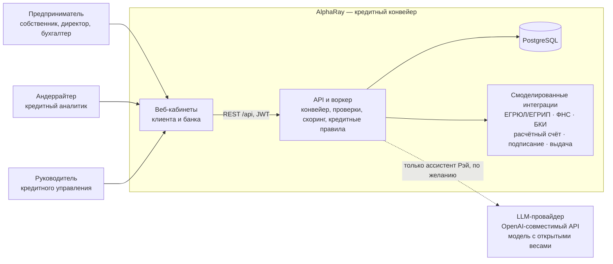
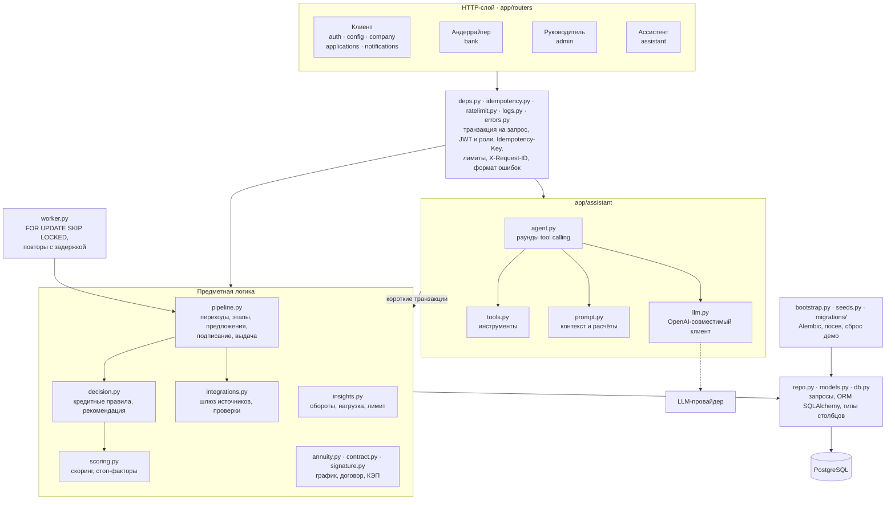
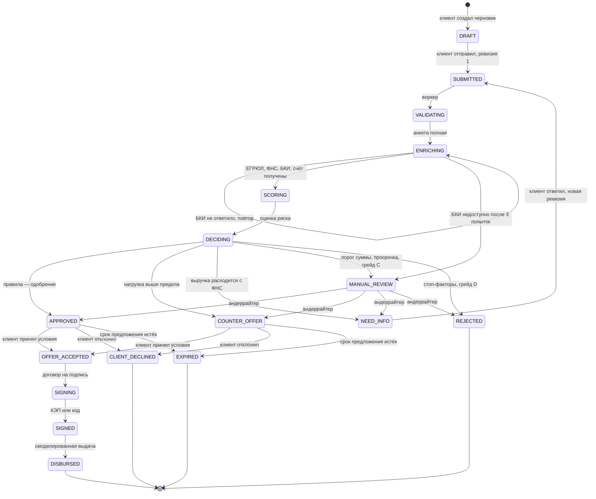
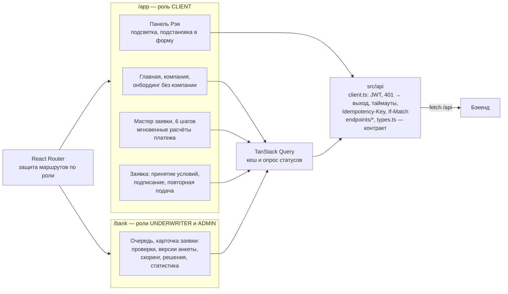
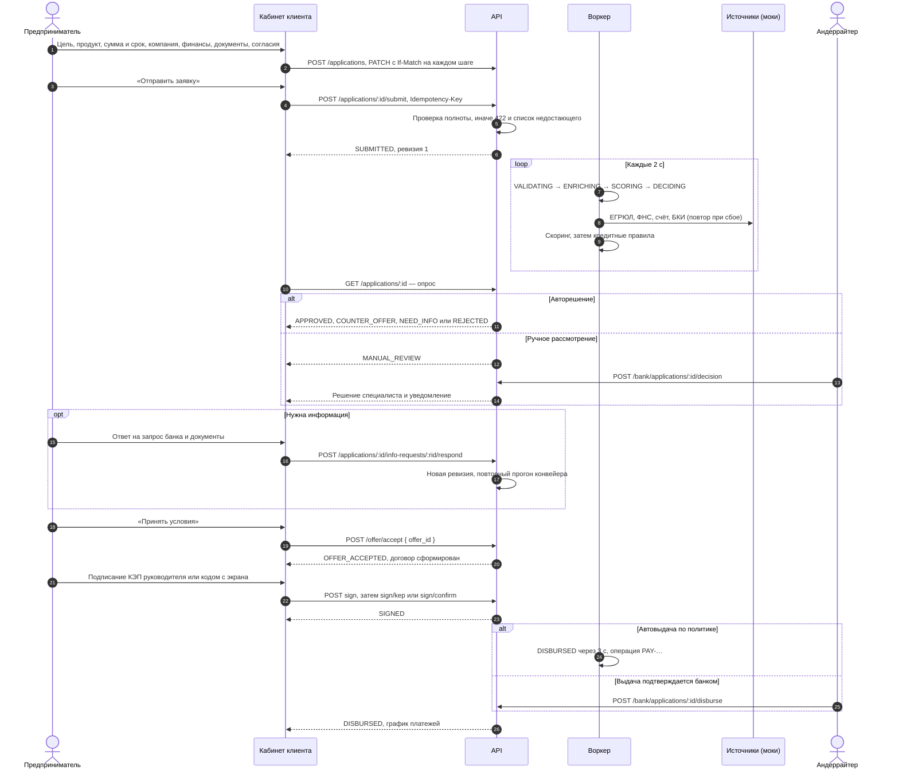
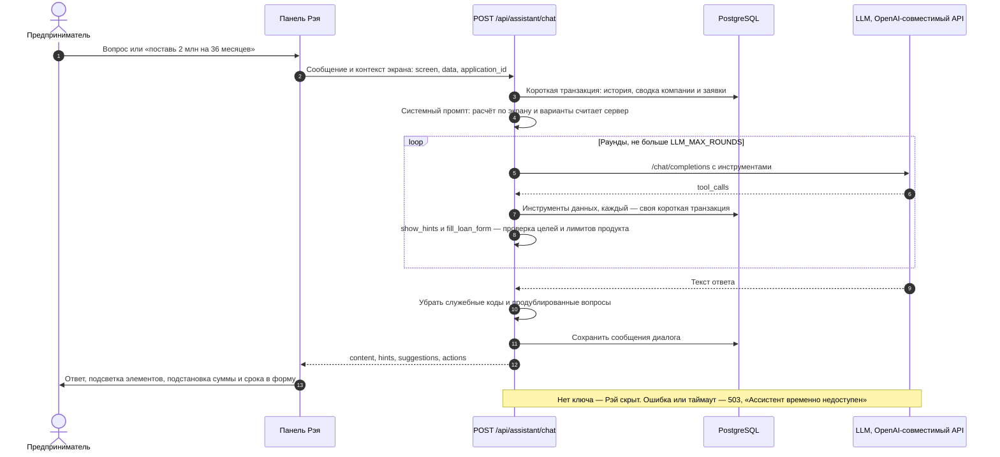
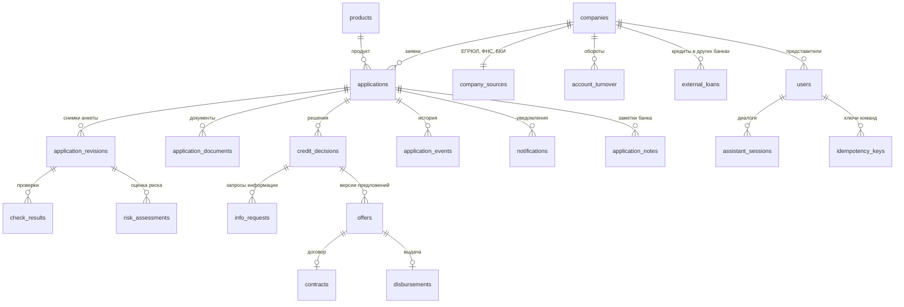

# Архитектура AlphaRay

AlphaRay — прототип цифрового кредитного конвейера для малого и микробизнеса. Один продукт объединяет три роли: предприниматель подаёт заявку и проходит путь до выдачи, андеррайтер разбирает нестандартные заявки, руководитель кредитного управления настраивает политику, продукты и распределение работы. Заявка проходит по единому конвейеру; данные и состояние хранятся в PostgreSQL, этапы выполняет воркер, фронтенд только отображает результат.

Схемы ниже — Mermaid, GitHub рисует их прямо на странице.

## 1. Контекст системы

- Весь сценарий проходит внутри продукта: без почты, SMS и мессенджеров. Уведомления, запросы банка, предложения и подписание — в кабинете.
- Внешние источники смоделированы с сохранением смысла интеграции: данные ЕГРЮЛ/ФНС/БКИ и обороты по счёту — синтетические таблицы, к которым ходит заменяемый шлюз `SourceGateway`; подписание — КЭП руководителя на смоделированном носителе или код на экране; выдача — запись об операции. Интерфейс и договор явно помечают подписание и выдачу как смоделированные.
- LLM нужна только ассистенту. Без ключа Рэй скрыт, основной сценарий от него не зависит, платные ресурсы для проверки не требуются.

## 2. Контейнеры и развёртывание

| Контейнер | Образ и сборка | Порт | Данные | Проверка и перезапуск |
|---|---|---|---|---|
| `postgres` | `postgres:17.6-alpine3.22`, закреплён по digest | `5432`, только внутри сети compose | том `postgres-data` | `pg_isready`, `restart: unless-stopped` |
| `backend` | `python:3.13-slim`, зависимости из `poetry.lock` с проверкой хешей, миграции в образе | `8000`, внутри сети | том `backend-data` → `/data/uploads` | `GET /api/health/ready`, стартует после `postgres: healthy` |
| `worker` | тот же образ, `python -m app.worker` | — | — | `restart: unless-stopped`, стартует после `postgres: healthy` |
| `frontend` | multi-stage: `node:22-alpine` собирает Vite, `nginx:1.27-alpine` отдаёт статику | `8080 → 80` | — | `wget /`, стартует после `backend: healthy` |
| `ollama` + `ollama-pull` | `ollama/ollama:0.40.5`, профиль `ollama` | `11434`, внутри сети | том `ollama-models` | скачивает модель `OLLAMA_MODEL` при первом запуске |

Запуск одной командой: `docker compose up --build` из корня. Конфигурация бэкенда — `backend/.env` (шаблон `backend/.env.example`), строка подключения к БД задаётся в `docker-compose.yml`, версии зафиксированы в `backend/poetry.lock` и `frontend/package-lock.json`. API и воркер при старте применяют миграции и загружают демо-данные в пустую базу под advisory-блокировкой, поэтому их можно запускать в любом порядке и количестве.

## 3. Бэкенд

| Модуль | Ответственность |
|---|---|
| `app/routers/*` | REST API под `/api`: клиент (`auth`, `config`, `company`, `applications`, `notifications`), андеррайтер (`bank`), руководитель (`admin`), ассистент (`assistant`), служебное (`health/live`, `health/ready`, `demo/reset`) |
| `app/deps.py`, `app/security.py` | транзакция на запрос (commit до отправки ответа), разбор JWT, роль и активность учётки, доступ клиента только к заявкам своей компании |
| `app/idempotency.py`, `app/ratelimit.py`, `app/logs.py`, `app/errors.py` | `Idempotency-Key` с сохранёнными ответами, лимиты частоты, JSON-логи и `X-Request-ID`, единый формат ошибок |
| `app/pipeline.py` | таблица переходов статусов, события и уведомления, этапы конвейера, ревизии анкеты, решения (авто и ручные), предложения и их истечение, принятие условий, подписание, выдача, автораспределение |
| `app/decision.py` | кредитные правила с кодами причин и рекомендация андеррайтеру; отдельно от скоринга |
| `app/scoring.py` | скоринг по 7 факторам (возраст бизнеса, выручка к сумме, платежи к выручке, платёжная дисциплина, рейтинг БКИ, динамика выручки, рентабельность), стоп-факторы, расхождения с ФНС |
| `app/integrations.py` | шлюз `SourceGateway` к ЕГРЮЛ/ЕГРИП, ФНС, БКИ и счетам в банке; синтетическая реализация с режимами сбоя; результат каждой проверки — `OK`, `ISSUES` или `ERROR` |
| `app/insights.py` | обороты по счёту, чистый денежный поток, долговая нагрузка, предварительный лимит, действующие кредиты, отчёт БКИ с собственными кредитами банка, предзаполнение финансов |
| `app/annuity.py`, `app/contract.py`, `app/signature.py` | аннуитетный платёж, график, HTML договора, сертификаты КЭП на смоделированном носителе руководителя |
| `app/worker.py` | очередь шагов: выбор созревших заявок `FOR UPDATE SKIP LOCKED`, шаг в savepoint, при сбое — задержка до минуты; поток внутри API или отдельный процесс |
| `app/models.py`, `app/repo.py`, `app/db.py` | ORM-модели SQLAlchemy 2.1, фасад запросов `Db`, типы столбцов: время в миллисекундах поверх `timestamptz`, pydantic-снимки поверх `JSONB` |
| `app/bootstrap.py`, `app/seeds.py`, `migrations/` | миграции Alembic и посев под advisory-блокировкой, синтетические данные, сброс демо (`python -m app.cli reset-demo`) |
| `app/assistant/*` | ассистент Рэй — раздел 7 |

### Воркер конвейера

У заявки в работе есть `next_run_at` — время следующего шага. Воркер раз в полсекунды берёт созревшие заявки по одной в транзакции: `SELECT … FOR UPDATE SKIP LOCKED`. Команды клиента и банка блокируют ту же строку `SELECT … FOR UPDATE`, поэтому отзыв во время работы конвейера даёт один согласованный исход, а несколько воркеров не обрабатывают одну заявку дважды. Время перехода считается от входа в этап, а не от момента обработки: после простоя воркера история событий такая же, как при непрерывной работе. Упавший шаг откатывается до savepoint, заявка откладывается с экспоненциальной задержкой. Тесты управляют часами и вызывают воркер явно — весь путь проверяется без ожидания.

## 4. Статусы и переходы

Диаграмма повторяет таблицу `TRANSITIONS` в `backend/app/pipeline.py`; любой другой переход сервер отклоняет (`409 INVALID_TRANSITION`). Из всех состояний до подписания клиент может отозвать заявку — `CANCELLED`, на схеме эти стрелки опущены.

Повторная подача после отказа, отклонения, отзыва или истечения создаёт новую заявку со ссылкой на прежнюю; конечные статусы не переписываются.

## 5. Фронтенд

- Всё общение с бэкендом — через `src/api`: остальное приложение не знает про HTTP. Типы в `src/api/types.ts` зеркалят `backend/app/schemas.py` и схему `docs/api/openapi.json`.
- Каждая команда уходит с новым `Idempotency-Key`; при обрыве сети клиент повторяет запрос с тем же ключом. Сохранение черновика передаёт `If-Match` с версией заявки.
- Статусы обновляются опросом: карточка заявки в обработке — каждые 2 с, подписание — 1 с, очередь андеррайтера — 5 с, список заявок в обработке — 5 с, уведомления и главная — 10 с.
- На клиенте остались только мгновенные расчёты интерфейса: платёж при движении ползунков, «впишется ли платёж», предоценка. Решение, скоринг, договор и график считает бэкенд.

## 6. Сквозной кредитный путь

Каждый переход пишет событие в историю заявки с `correlation_id`, этапы и решения создают уведомления клиенту, действия сотрудников банка попадают в журнал аудита. Исходы для любых компаний, включая демо, решают кредитные правила (`backend/README.md`, раздел «Кредитные правила»).

## 7. Ассистент Рэй

- Провайдер меняется переменными `LLM_BASE_URL`, `LLM_API_KEY`, `LLM_MODEL`; используются только модели с открытыми весами (по умолчанию `openai/gpt-oss-120b` у Groq).
- Цифры считает сервер, а не модель: платёж, переплата, доля в потоке, варианты условий и лимит приходят в промпт готовыми.
- Рэй объясняет и умеет одно действие — по просьбе клиента подставить сумму и срок в форму. Подсказки и действия проверяются на сервере: цели подсветки — по списку текущего экрана, сумма и срок — по границам продукта.
- Пока модель думает, соединение с БД не держится: инструменты открывают короткие транзакции, остальные запросы не ждут ассистента.

## 8. Данные

PostgreSQL 17, ORM — SQLAlchemy 2.1, драйвер psycopg 3, схема — миграции Alembic (`backend/migrations`). Время — `timestamptz` в UTC, деньги — целые рубли `BIGINT`, ставки — `NUMERIC`, снимки продукта, компании и финансов — `JSONB`, перечисления — `CHECK`-ограничения.

- Отправка и каждый ответ на запрос банка создают неизменяемую ревизию анкеты; проверки, оценка риска и решение ссылаются на ревизию, решение — ещё и на версию кредитной политики.
- Уникальные ограничения: номер заявки, версия предложения внутри заявки, одна выдача на заявку, номер операции выдачи, ключ идемпотентности на пользователя.
- Индексы — по компании и времени изменения, статусу, исполнителю, `next_run_at` очереди (частичный), истории заявки и журналу аудита.
- Загруженные файлы — в томе `backend-data` (`/data/uploads/<заявка>/<документ>`), в БД — метаданные, тип и SHA-256.
- Демо-данные загружаются один раз в пустую базу; обычный перезапуск их не трогает, сброс — явная команда `python -m app.cli reset-demo` или `docker compose down -v`.

## 9. Безопасность и надёжность

| Область | Как устроено |
|---|---|
| Аутентификация | JWT HS256 со сроком 12 ч, секрет — `JWT_SECRET` из окружения; пароли — PBKDF2-SHA256, 120 000 итераций |
| Авторизация | роли `CLIENT`, `UNDERWRITER`, `ADMIN` на каждом эндпоинте; клиент видит только заявки своей компании; инструменты Рэя читают данные только своей компании; заблокированный сотрудник получает 403 при входе и 401 на старый токен |
| Целостность | транзакция на запрос, commit до ответа; блокировка строки заявки на командах; таблица переходов; уникальные ограничения на выдачу и версии предложений; `Idempotency-Key` на командах; `If-Match` на черновике; принятие предложения сверяет его версию |
| Аудит | журнал действий банка с автором, ролью, временем и `correlation_id`: решения, назначения, заметки, выдачи, изменения продуктов, политики и сотрудников; история заявки — с инициатором и причиной каждого перехода |
| Секреты и контейнеры | `.env` не попадает в репозиторий и образы; бэкенд работает не от root; пароль БД задаётся окружением; лимит загрузки 20 МБ в nginx и на бэкенде |
| Недоверенный контент | договор собирается на сервере с экранированием и показывается в iframe с `sandbox`; ответ LLM очищается от служебных кодов, подсказки и действия валидируются |
| Внешние сервисы | сбой БКИ — до 3 попыток, затем ручное рассмотрение с кодом `INTEGRATION_ERROR`, а не отказ; LLM изолирована таймаутами (соединение 4 с, запрос 12 с, ответ целиком 18 с) и повторами при 429/5xx, при сбое — 503 без влияния на остальной сценарий |
| Нагрузка | лимиты частоты на вход, ассистента, загрузку файлов и команды; пул соединений БД; списки читаются выборками с подгрузкой связей |
| Наблюдаемость | JSON-логи с `correlation_id`; `X-Request-ID` в ответе и в теле ошибки; `GET /api/health/live` и `/api/health/ready` (БД, версия схемы, отставание очереди конвейера, статус ассистента) |
| Отказоустойчивость | healthcheck и автоперезапуск контейнеров; фронтенд стартует после готовности бэкенда, бэкенд и воркер — после готовности БД; состояние переживает перезапуск; задания конвейера хранятся в БД и продолжаются после падения воркера |
| Проверки | pytest на PostgreSQL — сценарии клиента, андеррайтера, администратора, агента на фейковой LLM и надёжности; Playwright — сквозные сценарии против реального бэкенда |

## 10. Ограничения прототипа и путь к промышленной версии

| Сейчас | Промышленно |
|---|---|
| Очередь конвейера — `next_run_at` в таблице заявок, воркер на `SKIP LOCKED` | брокер (Kafka или RabbitMQ) с outbox и идемпотентными обработчиками; оркестрация процесса — BPM-движок (Camunda, Temporal) |
| Синтетические ЕГРЮЛ, ФНС, БКИ и счета за шлюзом `SourceGateway` | адаптеры к реальным источникам за тем же интерфейсом, кеширование ответов, circuit breaker |
| Лимиты частоты в памяти процесса | общий счётчик в Redis для нескольких экземпляров API |
| Собственный JWT | единый вход банка через OIDC (Keycloak), mTLS между сервисами |
| Файлы в томе | S3-совместимое хранилище с антивирусной проверкой |
| Один экземпляр PostgreSQL | реплики, резервные копии с проверкой восстановления, PgBouncer |
| Логи в stdout | OpenTelemetry: трассировки, метрики конвейера и SLA, алерты |
| Сертификаты КЭП смоделированы на бэкенде | подпись в браузере через КриптоПро ЭЦП Browser plug-in (откреплённая CMS по ГОСТ Р 34.10-2012), проверка подписи, цепочки до УЦ ФНС и списков отзыва на сервере, полномочий — по ЕГРЮЛ или МЧД |
| LLM у внешнего провайдера | vLLM с моделью с открытыми весами внутри периметра банка — меняется только `LLM_BASE_URL` |

## 11. Технологии

| Слой | Технологии (версии из lock-файлов) |
|---|---|
| Бэкенд | Python 3.13, FastAPI 0.157, Starlette 1.9, Pydantic 2.14, pydantic-settings 2.16, SQLAlchemy 2.1, psycopg 3.3, Alembic 1.20, Uvicorn 0.54, PyJWT 2.15, httpx 0.28, Poetry 2.5 |
| База данных | PostgreSQL 17.6 |
| Фронтенд | React 18.3, React Router 6.30, TanStack Query 5.104, react-hook-form 7.90, zod 3.25, TypeScript 5.8, Vite 6.4 |
| Инфраструктура | Docker, docker compose, nginx 1.27, Node 22 для сборки, Ollama 0.40.5 по желанию |
| Качество | pytest 9.1, Ruff 0.17, ESLint 9, Playwright 1.64 |

Описание API — `docs/api/openapi.json` и Swagger UI на `/api/docs`; запуск и переменные окружения — `README.md`, `backend/README.md`, `frontend/README.md`.
